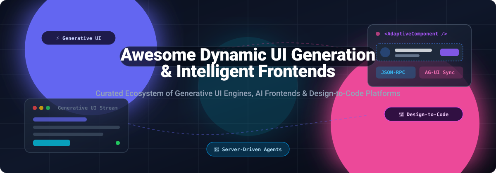

  

# ⚡ Awesome Dynamic UI Generation & Intelligent Frontends 🎨

**Curated List of SaaS Platforms & Open-Source Projects for Generative UI Engines, Prompt-to-Frontend Builders, Design-to-Code Compilers, Server-Driven UIs & Intelligent Frontend Runtimes** 🚀

*Track production-ready tools that generate, stream, adapt, and compile responsive React, Next.js, Vue, and Tailwind user interfaces from natural language prompts, live agent tool outputs, wireframes, and Figma designs.*

---

## 📑 Table of Contents
- [🔍 Sector Overview & Market Dynamics](#-sector-overview--market-dynamics)
- [☁️ SaaS & Hosted Platforms](#️-saas--hosted-platforms)
- [💻 Open-Source GitHub Projects](#-open-source-github-projects)
- [🛠️ Architectural Guidance & Best Practices](#️-architectural-guidance--best-practices)
- [🤝 How to Contribute](#-how-to-contribute)
- [💖 Support & Share](#-support--share)
- [📈 Star History](#-star-history)
- [⚠️ Disclaimer](#️-disclaimer)

---

## 🔍 Sector Overview & Market Dynamics

The global market for AI-driven software development tools, Generative UI, and low-code/design-to-code platforms is projected to expand from **$7.4B–$9.5B in 2025–2026** toward over **$31B+ by the late 2020s** at an estimated CAGR exceeding 25%.

The sector is currently **moderately fragmented**: incumbent tech titans (e.g., Alphabet/Google, Microsoft/GitHub) anchor broad foundational ecosystems, while specialized high-velocity venture-backed startups (such as Vercel, Framer, and Builder.io) dominate the modern prompt-to-component, design-to-code, and streaming Generative UI layers without a single winner-take-all monopoly.

---

## ☁️ SaaS & Hosted Platforms

Below is a detailed comparison of premier SaaS solutions for Generative UI, prompt-to-app development, and design-to-code compilation. Products are sorted in descending order based on company size (market valuation / revenue scale).

| Platform | Company Valuation / Revenue Scale | Specific Starting Tier Price | Free Tier / Free Trial Limits | Description |
| :--- | :--- | :--- | :--- | :--- |
| [**Stitch by Google**](https://withgoogle.com) *(formerly Galileo AI)* | **~$3.4 Trillion Market Cap** *(Alphabet Inc.)* | Integrated into Google Cloud / Workspace Developer Tiers | Free tier via Google Cloud free trial ($300 credits for 90 days) & Google AI Studio free tier limits (up to 15 RPM / 1M TPM on Gemini models) | Generative UI design platform converting natural language prompts and rough sketches into multi-screen UI mockups and clean HTML/CSS/Figma exports. |
| [**Vercel v0**](https://v0.dev) | **$9.3 Billion Valuation** *(Series F, ~$300M+ ARR)* | **$30 / user / month** *(Plus Tier)* | **Forever-Free Plan**: $5 monthly credit allowance capped at a strict maximum of **7 messages per day** | AI-native generative UI system producing production-ready React, Next.js, Tailwind CSS, and `shadcn/ui` components from text prompts and design screenshots. |
| [**Framer AI**](https://framer.com) | **~$2.0 Billion Valuation** *(estimated, ~$40M+ ARR)* | **$10 / site / month** *(Basic Tier, billed annually)* | **Forever-Free Plan**: 1,000 pages, up to 10 CMS collections, 500 one-off AI credits, 1 locale; publishing locked to `*.framer.website` subdomain with "Made in Framer" badge | Visual web builder and interactive canvas featuring automated AI layout generation, responsive breakpoints, localized copy, and motion animations. |
| [**Builder.io**](https://builder.io) *(Visual Copilot)* | **~$250 Million Valuation** *(Series B, $15M–$19M ARR)* | **$24 / user / month** *(Pro Tier)* | **Forever-Free Plan**: Up to 5 users, 1 design system, and a metered quota of **60 AI credits per month** (capped at 15 credits per day) | Headless visual CMS and design-to-code engine transforming Figma frames and prompts into clean, component-mapped React, Vue, Svelte, and Angular code. |
| [**Uizard**](https://uizard.io) *(Miro)* | **~$60 Million Valuation** *(Acquired by Miro)* | **$12 / creator / month** *(Pro Tier, billed annually)* | **Forever-Free Plan**: 2 projects, up to 5 screens per project, 10 pre-made templates, and **3 AI generations per month** (standard 1x resolution export) | Rapid AI wireframing and prototyping platform converting hand-drawn sketches, app screenshots, and prompts into interactive multi-screen mockups. |
| [**Locofy.ai**](https://locofy.ai) | **~$35 Million Valuation** *($7.3M total VC funding)* | **$40 / month** *(Hobby Tier)* | **Free / Trial Allocation**: One-time grant of **2,000 LDMtokens** with frame-conversion limits for single-frame evaluation | AI design-to-code platform powered by Large Design Models (LDMs) turning Figma and Adobe XD prototypes into responsive React, Next.js, and Vue codebases. |
| [**Relume**](https://relume.io) | **~$25 Million Valuation** *(Bootstrapped/Profitable, ~$4M+ ARR)* | **$18 / month** *(Starter Tier)* | **Forever-Free Plan**: 1 active project, single-page sitemap generation, up to 1,500 monthly hosted page views on `relumesite.ai` subdomain | AI-powered sitemap and wireframe generator mapping prompts directly onto modular Figma, Webflow, and React/Tailwind component systems. |
| [**Anima App**](https://animaapp.com) | **~$20 Million Valuation** *(YC-backed, ~$1.5M ARR)* | **$20 / month** *(Starter Tier)* | **Forever-Free Plan**: 5 AI playground messages per day, max 5 total Figma imports/clones, and 5 lifetime code generation exports | Design-to-code automation platform translating Figma designs into live React, Vue, and HTML/Tailwind code with live sandboxes and design-token sync. |
| [**TeleportHQ**](https://teleporthq.io) | **~$12 Million Valuation** *($3.67M total funding)* | **$14 / month** *(Pro Tier)* | **7-Day Free Trial**: 1 project, up to 200 pages, 30,000 AI tokens; code export disabled (read-only preview), published sites password-protected | Collaborative visual frontend platform offering rapid UI prototyping and code generation for React, Next.js, Vue, Nuxt, and HTML. |
| [**Fronty**](https://fronty.com) | **~$5 Million Valuation** *(Early Stage/Seed)* | **$4.52 / month** *(Pro Tier)* | **Forever-Free Plan**: 1 image-to-HTML conversion per day; hosting restricted to `fronty.live` subdomain without downloadable standalone code export | Computer vision and AI image-to-HTML/CSS converter creating structured web layouts from screenshots and design files. |

---

## 💻 Open-Source GitHub Projects

Explore the leading open-source repositories powering Generative UI runtimes, AI frontend frameworks, and design-to-code compilers. Entries are decorated with live GitHub star badges linking directly to their stargazers page and ranked in descending order by star count.

| Project & Repository | Stars | Category & Architecture | Description |
| :--- | :--- | :--- | :--- |
| **[shadcn/ui](https://github.com/shadcn-ui/ui)** |  | UI Component Primitives | The definitive accessible component architecture copied into your codebase via CLI; used as the default target system by v0, Claude Artifacts, and modern AI UI engines. |
| **[screenshot-to-code](https://github.com/abi/screenshot-to-code)** |  | Vision-to-Code Compiler | Converts UI screenshots, mockup images, and Figma prototypes into clean HTML, Tailwind CSS, React, Vue, and Ionic code using multimodal LLMs. |
| **[CopilotKit](https://github.com/CopilotKit/CopilotKit)** |  | Agentic & Generative UI Stack | Full-stack framework for building in-app AI copilots, generative UI sidebars, and real-time streaming React components synchronized with agent state. |
| **[Continue](https://github.com/continuedev/continue)** |  | Open Coding Agent & IDE Engine | Leading open-source AI code assistant and agentic copilot for VS Code and JetBrains; facilitates dynamic code generation, refactoring, and UI prototyping. |
| **[Vercel AI SDK](https://github.com/vercel/ai)** |  | Streaming AI Toolkit | TypeScript toolkit for building AI-powered web applications with streaming text, structured UI schemas, dynamic tool-call rendering, and React Server Components. |
| **[Onlook](https://github.com/onlook-dev/onlook)** |  | Visual DOM & React Code Editor | Next-generation visual designer tool ("Cursor for Designers") that lets teams visually edit React and Tailwind websites and writes clean code back to source. |
| **[GrapesJS](https://github.com/GrapesJS/grapesjs)** |  | Extensible Web Builder Framework | Battle-tested open-source visual page builder engine featuring drag-and-drop canvases, CSS managers, and JSON serialization for embedded UI builders. |
| **[Magic UI](https://github.com/magicuidesign/magicui)** |  | Animated Component Library | 50+ animated, interactive React/Tailwind primitives designed for landing pages and modern AI-generated frontend experiences. |
| **[OpenUI](https://github.com/wandb/openui)** |  | Prompt-to-UI Playground | Generative UI exploration platform by Weights & Biases allowing developers to describe components in natural language, live-preview HTML/React, and test with Ollama. |
| **[Dyad](https://github.com/dyad-sh/dyad)** |  | Local-First AI App Builder | Free, open-source desktop AI application and frontend generator (v0 / Lovable alternative) supporting local Ollama models and cloud APIs. |
| **[AG-UI Protocol](https://github.com/ag-ui-protocol/ag-ui)** |  | Agent-UI Protocol Specification | Open, event-based Agent-User Interaction protocol standardizing real-time bidirectional state and UI streaming between AI agents and frontend clients. |
| **[Bolt.diy](https://github.com/stackblitz-labs/bolt.diy)** |  | Full-Stack In-Browser Sandbox | Open-source prompt-to-app generator powered by WebContainers, allowing developers to scaffold, edit, preview, and deploy full-stack apps with any LLM. |
| **[json-render](https://github.com/vercel-labs/json-render)** |  | Declarative Generative UI | Framework by Vercel Labs for safely streaming constrained JSON component trees from LLMs and rendering them dynamically on web clients. |
| **[A2UI](https://github.com/google/A2UI)** |  | Agent-to-UI Framework | Google's open-source generative UI framework allowing autonomous agents to stream layout specifications and render dynamic interactive UI components. |
| **[Puck](https://github.com/measuredco/puck)** |  | Visual React Editor | Modular, self-hosted open-source visual page editor for React that uses your existing component library and design system tokens. |
| **[assistant-ui](https://github.com/assistant-ui/assistant-ui)** |  | React AI Chat & Generative Primitives | Modular React primitives for AI chatbots, generative UI widgets, interactive tool calls, streaming markdown, and human-in-the-loop workflows. |
| **[Papermark](https://github.com/mfts/papermark)** |  | Document & Presentation Frontend | Open-source DocSend alternative featuring modern interactive document viewers, web analytics, and dynamic custom frontend branding. |
| **[Webstudio](https://github.com/webstudio-is/webstudio)** |  | Open-Source Visual Builder | Open-source visual builder and Webflow alternative engineered on open CSS standards and dynamic headless CMS integrations. |
| **[Plasmic](https://github.com/plasmicapp/plasmic)** |  | Visual Headless CMS Studio | Visual design tool and page builder that integrates cleanly into existing Next.js, Gatsby, and React codebases for continuous design handoff. |
| **[cc-intelligent-ui](https://github.com/razorback16/cc-intelligent-ui)** |  | Claude Dynamic UI Toolkit | Specialized intelligent frontend toolkit rendering interactive charts, LaTeX math, diagrams, and markdown responses dynamically from LLM streams. |

---

## 🛠️ Architectural Guidance & Best Practices

1. **Security & Sandboxing (Zero-Trust UI)**: Never execute raw AI-generated JavaScript strings (`eval` or `dangerouslySetInnerHTML`). Emphasize declarative JSON schemas (`json-render`, `A2UI`, or AG-UI Protocol) mapped to vetted component registries.
2. **Design System Alignment**: Standardize LLM prompt system instructions around established headless primitives (like `shadcn/ui` and Radix) to ensure high aesthetic consistency and WCAG accessibility standards.
3. **State Management & Bidirectional Sync**: Use event-driven runtime protocols (such as CopilotKit AG-UI) to synchronize in-app user interactions back to the backend agent state loop.

---

## 🤝 How to Contribute

Contributions are welcome and appreciated! To propose a new SaaS platform or open-source repository:

1. 🍴 **Fork the Repository** on GitHub.
2. 🌿 **Create a Feature Branch** (`git checkout -b feature/add-new-ui-tool`).
3. 📝 **Add Your Entry**: Ensure SaaS entries include verified starting tier prices, specific free tier limits, and company scale. Open-source entries must include a verified repo URL and social star badge.
4. 🚀 **Submit a Pull Request** with a concise description of the tool's relevance to dynamic and intelligent frontend generation.

---

## 💖 Support & Share

Thank you for exploring and supporting the **Dynamic UI Generation & Intelligent Frontends** ecosystem!

If you find this curated collection helpful for your engineering projects, research, or daily workflows, please consider supporting the project:

- ⭐ **Star this repository** to help others in the AI and frontend community discover it.
- 🍴 **Fork & Share** with your fellow developers, engineering teams, and on social media (X/Twitter, LinkedIn).
- ☕ **Sponsor & Buy Me a Coffee**: Support ongoing maintenance, automated tools verification, and research directly via the [GitHub Sponsor Dashboard](https://github.com/sponsors/ishandutta2007).

---

## 📈 Star History

---

## ⚠️ Disclaimer

- This is a community-curated repository provided for educational and architectural reference. Inclusion does not constitute an official endorsement.
- All dynamic UI code generators and LLM component streams must be properly validated against strict schemas (e.g. Zod) and Content Security Policies (CSP) prior to production deployment.
- Verify software license terms and pricing details directly on the respective vendor websites as specifications evolve.
